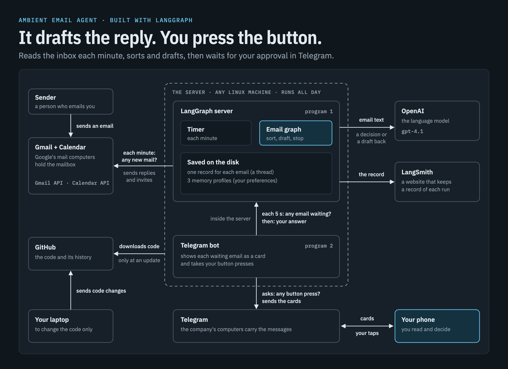
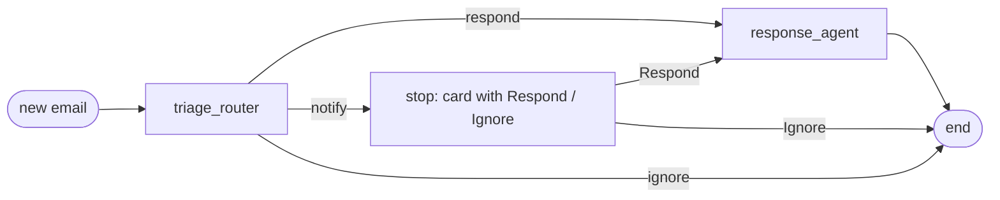

# Ambient email agent (LangGraph)

An email assistant that reads a Gmail inbox, sorts each email, and drafts the reply or the meeting invite. It then stops and asks for approval in Telegram. Nothing is sent before a person presses a button. The corrections it gets rewrite its stored preferences, so its drafts change with use.



## What it does

- **Sorts each email** into `respond`, `notify` or `ignore`.
- **Drafts** a reply, or checks the calendar and drafts a meeting invite, a move or a cancellation.
- **Waits for a person.** Each action is a card in Telegram with Accept, Respond and Ignore.
- **Learns.** An answer in your own words can rewrite one of three preference profiles: triage, reply style, calendar.
- **Checks Gmail on a schedule.** A cron job (a task that the server starts on a timer) reads the inbox, for example each minute.
- **Cleans up.** A daily job takes each finished email out of the server's memory after a day. One line with its ID stays, so it is never processed twice.

## How it works

Two programs run on one machine:

1. **The LangGraph server** (`langgraph dev`) with four graphs (a graph is a program made of steps): the email graph, a `cron` graph that reads Gmail, a `preferences` graph behind the bot's `/prefs` command, and a `cleanup` graph.
2. **The Telegram bot** (`scripts/telegram_inbox.py`). It asks the server for emails that wait for an answer, shows each one as a card, and sends the answer back. It uses long polling: the bot calls Telegram and asks for new messages, so the machine needs no public port.

The email graph:



Inside `response_agent`, the model picks one tool at a time. A calendar check runs at once. Each other tool (send an email, schedule, move or cancel a meeting, ask a question) stops the graph with `interrupt()` until the person answers. The state is saved, so an answer can come hours later.

| Folder | What is in it |
|---|---|
| `src/email_assistant/` | The graphs, the prompts, the Gmail and Calendar tools, the ingester |
| `scripts/` | The Telegram bot and its message rendering |
| `tests/` | Offline tests: no server, no model call, no Google call |
| `deploy/` | Two systemd service files and a script for the Gmail sign-in |

## What you need

- **[`uv`](https://docs.astral.sh/uv/getting-started/installation/) and git.** `uv` installs the Python packages and runs each command. It also downloads Python 3.11, the version in `.python-version`, if your computer does not have it (`pyproject.toml` accepts 3.11 to 3.13).
- **An OpenAI account with an [API key](https://developers.openai.com/api/docs/quickstart) and credit.** The agent uses the model `gpt-4.1`, which is set in the code. OpenAI charges for each model call, so each email costs a little.
- **A Telegram account.** The cards and the buttons are in a Telegram chat.
- **A Google account** whose Gmail the agent will read (this guide calls it "the mailbox"), and **a Google Cloud project**, which you create in step 4. Google needs the project before it lets a program use the mailbox.
- **A second email address**, to send test emails to the mailbox.
- **Optional: a [LangSmith](https://docs.langchain.com/langsmith/create-account-api-key) account.** LangSmith keeps a record of each run, which helps when you look for a fault.

The commands are for macOS and Linux. Run each one from the folder of the repository.

## Set up

### 1. Get the code and install

```bash
git clone https://github.com/nikolay-bb/langgraph-email-agent.git langgraph-email-agent
cd langgraph-email-agent
uv sync --group bot --group dev
```

**It worked when** the last command ends with no error and a `.venv` folder is there. **Most likely mistake:** `uv: command not found`. Open a new terminal after you install `uv`.

### 2. Create the Telegram bot

1. In Telegram, open [@BotFather](https://t.me/botfather) and send `/newbot`. Give the bot a name and a username that ends in `bot`. BotFather answers with a **token**: a long secret string that lets a program control the bot ([Telegram's guide](https://core.telegram.org/bots/features#botfather)).
2. Open the chat with your new bot and press **Start**. A bot cannot start a chat; you must write to it first.
3. Find your **chat ID**, the number of your chat with the bot. Open this address in a browser, with your token in place of `<token>`:

   ```text
   https://api.telegram.org/bot<token>/getUpdates
   ```

   Use a private browser window, so the token does not stay in the browser's history. In the answer, find `"message"`, then `"chat"`, then `"id"`. That number is your chat ID. The bot answers this one chat only: it ignores a message from any other chat and writes that chat's ID to its log.

**It worked when** the answer starts with `{"ok":true` and holds your message. **Most likely mistake:** `"result":[]` means that the bot has no new message. Send it one and load the address again. Do this before step 5: a bot program that runs takes the messages first.

### 3. Create `.env`

`.env` is a text file that holds the settings and the secret keys. Copy the example, let only your user read the copy (`chmod 600`), then open `.env` in an editor and fill it in.

```bash
cp .env.example .env
chmod 600 .env
```

| Setting | Needed | Default | What it is |
|---|---|---|---|
| `OPENAI_API_KEY` | yes | none | Your OpenAI API key. |
| `TELEGRAM_BOT_TOKEN` | yes | none | The token from @BotFather. |
| `TELEGRAM_CHAT_ID` | yes | none | The chat ID from step 2, a whole number. |
| `LANGSMITH_TRACING` | no | `false` in `.env.example` | `true` sends a record of each run to LangSmith, the email text included. It needs the key below. Keep the line in `.env`: with a key and no such line, the server switches tracing on. |
| `LANGSMITH_API_KEY` | with tracing | empty | Your LangSmith key. |
| `LANGSMITH_PROJECT` | no | `langgraph-email-agent` | The LangSmith project that gets the records. |
| `LANGSMITH_ENDPOINT` | no | the US endpoint | The region of your LangSmith account. For an EU account, set `https://eu.api.smith.langchain.com` (the line is in `.env.example`, switched off). A key works in its own region only. |
| `LANGGRAPH_URL` | no | `http://127.0.0.1:2024` | Where the bot finds the server. |
| `TELEGRAM_POLL_SECONDS` | no | `5` | How often the bot asks the server for waiting emails. |
| `TELEGRAM_ENABLE_EDIT` | no | `0` | `1` adds an Edit button to the cards. |
| `TELEGRAM_ASSISTANT_ID`, `TELEGRAM_PREFS_ASSISTANT_ID`, `TELEGRAM_MEMORY_NAMESPACE` | no | `email_assistant_hitl_memory_gmail`, `preferences`, `email_assistant` | The two graphs that the bot uses, and where it reads the stored profiles. Do not change them. |
| `TELEGRAM_STATE_FILE` | no | `logs/telegram_bot_state.json` | Where the bot keeps the ID of its last list message. |
| `TELEGRAM_ALLOW_IPV6`, `GOOGLE_ALLOW_IPV6` | no | empty | The bot uses IPv4 for Telegram, and the Google calls try IPv4 first. `1` goes back to the system's own order. |

**Most likely mistake:** to set `LANGSMITH_TRACING=true` with no key, or with a key from another region. Add the key and the endpoint of your region, or set it back to `false`.

### 4. Give the agent access to Gmail and Calendar

Two terms. An **OAuth client** is the identity of this program at Google. A **token** is a file that proves that you let this program use your mailbox. You make the client one time in the [Google Cloud console](https://console.cloud.google.com/), then a script makes the token.

1. **Create a project.** Menu > **IAM & Admin** > **Create a Project** ([Google's guide](https://developers.google.com/workspace/guides/create-project)).
2. **Switch on two APIs.** Menu > **APIs & Services** > **Library**. Find **Gmail API** and click **Enable**. Do the same for **Google Calendar API** ([guide](https://developers.google.com/workspace/guides/enable-apis)).
3. **Configure the consent screen.** Menu > **Google Auth platform** > **Branding** > **Get Started**. Give an app name and your email address. For **Audience**, select **External**. Agree to Google's data policy and click **Create**. Then open **Audience**, and under **Test users** click **Add users** and add the address of the mailbox ([guide](https://developers.google.com/workspace/guides/configure-oauth-consent)). You can leave **Data Access** empty: the script asks for the permissions itself.
4. **Create the OAuth client.** **Google Auth platform** > **Clients** > **Create Client** > **Application type**: **Desktop app** > **Create**. Download the JSON file of the client ([guide](https://developers.google.com/workspace/guides/create-credentials#desktop-app)).
5. **Save the file** at the path that the code reads:

   ```bash
   mkdir -p src/email_assistant/tools/gmail/.secrets
   mv <path-to-the-downloaded-file> src/email_assistant/tools/gmail/.secrets/secrets.json
   ```

6. **Sign in.** Do this on a computer with a browser:

   ```bash
   uv run python src/email_assistant/tools/gmail/setup_gmail.py
   ```

   A browser opens. Sign in as the mailbox, not as another Google account.

**The "Google hasn't verified this app" screen.** Google shows it for each app that asks for wide permissions and that Google did not review. The app is your own, so click **Advanced**, then **Go to (your app name) (unsafe)**.

**The two permissions.** Gmail (`gmail.modify`): to read new email, send the replies that you accept, and mark an answered email as read. Calendar (`calendar`): to see your free time and to create, move and cancel meetings. Allow both. If Google shows a tick box for each one, tick both.

**It worked when** the terminal prints `Authentication successful!` and `Access token stored at ...token.json`. The script makes the `.secrets` folder and the token file readable by your user only. **Most likely mistakes:** `Error: Client secrets file not found` means a wrong path or file name in item 5. `Error 403: access_denied` in the browser means that the mailbox is not in **Test users**.

**The 7-day limit.** While the app's publishing status is **Testing**, Google ends the sign-in 7 days after you gave it ([Google's page](https://developers.google.com/identity/protocols/oauth2#expiration)). Then each Gmail and Calendar call fails with `invalid_grant`. You have two options. Run `setup_gmail.py` again each week. Or open **Google Auth platform** > **Audience** and click **Publish app**, so the status is **In production**: for personal use, Google asks for no verification, and the warning screen stays ([Google's page](https://support.google.com/cloud/answer/13464323)). Then run `setup_gmail.py` one more time to get a token without the 7-day limit.

### 5. Start the server and the bot

Use two terminals. The first one runs the server:

```bash
uv run langgraph dev --no-browser
```

**It worked when** it prints `Welcome to`, a large LangGraph logo and a line with `API: http://127.0.0.1:2024`. Do not close it. **Most likely mistake:** `Missing credentials` in its output means that `OPENAI_API_KEY` is empty in `.env`.

The second terminal runs the bot:

```bash
uv run --group bot python scripts/telegram_inbox.py
```

**It worked when** it prints a line that ends with `watching email_assistant_hitl_memory_gmail on http://127.0.0.1:2024, answering only chat` and your chat ID. Then send `/start` to the bot in Telegram: it answers `Connected.` **Most likely mistakes:** `KeyError: 'TELEGRAM_BOT_TOKEN'` means that there is no `.env` file. `ValueError: invalid literal for int()` means that `TELEGRAM_CHAT_ID` is empty or is not a number. No answer to `/start` means a wrong chat ID: the bot's terminal shows `ignored message from chat` and the number of the chat that you wrote from.

### 6. First test

1. From your second address, send an email to the mailbox. Ask a direct question, for example "Can we meet on Thursday at 14:00 for 30 minutes?". Do not open it in Gmail: the agent reads unread email only.
2. In a third terminal, ingest it by hand (to ingest is to read the email from Gmail and give it to the agent). Use the address of the mailbox:

   ```bash
   uv run python src/email_assistant/tools/gmail/run_ingest.py --email you@example.com --minutes-since 120
   ```

   `--minutes-since 120` reads the unread email of the last 120 minutes. **It worked when** the output has `Found 1 emails` and ends with `Processed 1 emails, skipped 0 already processed and 0 sent by this mailbox`.
3. In Telegram, the bot posts `1 waiting` with one button for the email. Press it. The card shows the email, then `Proposed:` and the draft.

| Button | What it does |
|---|---|
| **Accept** | Does the action as the card shows it: sends the reply, or creates, moves or cancels the meeting. |
| **Respond** | Does nothing yet. The bot asks for your text. The agent makes a new draft from it and shows a new card. On a `notify` card, your text tells the agent to write a reply. If your text is a lasting rule ("always ..."), the agent can save it in a profile; the bot then shows `Preference noted`. |
| **Ignore** | Does nothing and ends the work on this email. |
| **Edit** | Only with `TELEGRAM_ENABLE_EDIT=1`. You change single fields of the draft, then press Send. |
| **Full text**, **Back to list** | Shows the whole email; goes back to the list. |

One email can need more than one card. After you accept an invite, the agent drafts the reply that confirms it. After a sent reply, the bot shows `Reply sent` and the agent marks the email as read in Gmail. The bot has three commands. `/list` shows the emails that wait. `/prefs` shows the three profiles and lets you change one in plain words (Change, type your text, Apply). `/start` shows the graph, the server address and the poll interval.

**Most likely mistakes:** no card arrives when the email asks for nothing (the agent sorts it as `ignore`), or when you sent it from the mailbox to itself (the ingester skips email that the mailbox sent). Other options of `run_ingest.py`: `--include-read` also reads email that is read, `--rerun` processes an email again, `--early` stops after the first email.

### 7. Make it automatic

Two cron jobs do the routine work: the first checks Gmail, the second is the daily clean-up. The server must run when you set them.

```bash
uv run python src/email_assistant/tools/gmail/setup_cron.py --email you@example.com --schedule "* * * * *"
uv run python src/email_assistant/cleanup.py --schedule "30 3 * * *"
```

**It worked when** you see `Cron job created successfully with schedule: * * * * *` and `Clean-up cron job created with schedule: 30 3 * * * (UTC)`.

A schedule has five fields: minute, hour, day of the month, month, day of the week. `*` means "each". So `* * * * *` is each minute, `*/10 * * * *` is each 10 minutes (the default of `setup_cron.py`), and `30 3 * * *` is 03:30 each day. The times are in UTC ([LangChain's page on cron jobs](https://docs.langchain.com/langsmith/cron-jobs)).

- **The Gmail job** reads the unread email of the last 60 minutes (`--minutes-since`) and skips each email that it processed before. Keep it at each minute if you can. Each run also makes the development server write its saved state to disk again, which that server stops doing after the bot reads an email (`src/email_assistant/dev_server.py` has the details).
- **The clean-up job** removes each finished email with no change for 1 day (`--days`) from the server. It writes one line for each to `logs/processed_emails.jsonl`. It never removes an email that waits for your answer. `cleanup.py --now` starts one clean-up at once.

There is one job of each type: a second run of the command replaces the job. The jobs stay after a restart of the server. To remove them:

```bash
uv run python src/email_assistant/tools/gmail/setup_cron.py --delete
uv run python src/email_assistant/cleanup.py --delete
```

### 8. Make it yours

- **The default profiles** are four texts in `src/email_assistant/prompts.py`. `default_background` says who you are (the example is "Alex, a project manager"). `default_triage_instructions`, `default_response_preferences` and `default_cal_preferences` are the three profiles. Change them before the first email, then start the server again.
- **After the first email, use `/prefs`.** The server copies each of the three profiles into its store at first use. From then on it reads the stored copy, and a change in `prompts.py` has no effect. `default_background` is not stored: the server reads it from the file.
- **The time zone** is `MEETING_TIMEZONE = "Europe/London"` in `src/email_assistant/utils.py`. **The working hours** are `WORK_START` and `WORK_END` (09:00 and 17:00) in `src/email_assistant/tools/gmail/gmail_tools.py`. The prompts repeat both in words ("UK time", "Europe/London", "09:00 and 17:00") in `prompts.py`, in `tools/gmail/prompt_templates.py` and in `email_date` in `utils.py`. Change those too.
- **To start again from nothing**, stop the server and delete the `.langgraph_api/` folder. This removes the waiting emails, the stored profiles and the cron jobs.

## Run it on a server (optional)

These steps are for a small Linux machine that is always on and uses systemd (the part of most Linux systems that starts programs at boot and starts them again when they stop). Do steps 1 to 6 on your own computer first: the Gmail sign-in needs a browser.

1. **Install on the server.** Open a new shell after the first command.

   ```bash
   curl -LsSf https://astral.sh/uv/install.sh | sh
   git clone https://github.com/nikolay-bb/langgraph-email-agent.git ~/langgraph-email-agent
   cd ~/langgraph-email-agent && uv sync --group bot
   ```

2. **Copy the secrets** from your computer through SSH. Do not send them by email or chat.

   ```bash
   scp .env YOUR_USER@YOUR_SERVER:langgraph-email-agent/.env
   scp -r src/email_assistant/tools/gmail/.secrets YOUR_USER@YOUR_SERVER:langgraph-email-agent/src/email_assistant/tools/gmail/
   ```

   Then, on the server, in the repository folder: `chmod 600 .env` and `chmod -R go-rwx src/email_assistant/tools/gmail/.secrets`.
3. **Install the two service files.** They expect the code in `/home/YOUR_USER/langgraph-email-agent` and `uv` in `/home/YOUR_USER/.local/bin/uv`. These commands put your user name in place of `YOUR_USER`:

   ```bash
   for unit in email-agent-server email-agent-bot; do
     sed "s/YOUR_USER/$USER/g" deploy/$unit.service | sudo tee /etc/systemd/system/$unit.service > /dev/null
   done
   sudo systemctl daemon-reload
   sudo systemctl enable --now email-agent-server email-agent-bot
   ```

4. **Set the two cron jobs** on the server (step 7). Each server keeps its own jobs.
5. **Read the logs:**

   ```bash
   journalctl -u email-agent-server -f
   journalctl -u email-agent-bot -f
   ```

6. **Update** after a change in the repository. The server loads new code only at a restart.

   ```bash
   cd ~/langgraph-email-agent && git pull && uv sync --group bot
   sudo systemctl restart email-agent-server email-agent-bot
   ```

Three rules:

- **Only one bot process for each token.** Stop the bot on your computer before you start it on the server. Telegram refuses the second one with a `Conflict` error.
- **Only one server.** Each server keeps its own record of the emails that it processed, so two servers process each email twice.
- **Renew the Gmail sign-in** if the Google app is in Testing: run `setup_gmail.py` on your computer and copy the new `token.json` to the server. No restart is necessary; the agent reads the file at each Google call. `deploy/renew_gmail.sh` is an example for a machine on Google Cloud. It does both steps with `gcloud` and needs three variables:

  ```bash
  GCP_PROJECT=<project> GCP_ZONE=<zone> VM_NAME=<machine> bash deploy/renew_gmail.sh
  ```

## Security: read this before you run it

- **The server has no sign-in.** `langgraph dev` is a development server. Each program that can reach its port can read the stored emails and can approve an action that waits. Keep it on `127.0.0.1`, which is its default. Never use `--host 0.0.0.0` or `--tunnel`. On a computer with a browser, a web page that you open can also call this port: one more reason to run the agent on a machine with no browser.
- **Keep each inbound port closed.** The bot uses long polling and the server only calls out to Google and OpenAI, so the machine needs no open inbound port.
- **`token.json` is a key to the mailbox.** A person who has it can read and send your email and change your calendar. `secrets.json` and `.env` are secrets too. Never commit them. `.env`, `.secrets/`, `logs/` and `.langgraph_api/` are on the ignore list of git: do not take them off it.
- **Personal data stays on the machine** in `.langgraph_api/` (email text, drafts, profiles), in `logs/` and in the server log (senders and subjects). Protect the machine and its backups.
- **LangSmith gets the text, if you switch tracing on.** With `LANGSMITH_TRACING=true`, the text of each email, each draft and the calendar data go to LangSmith. It is `false` in `.env.example`. After a change in `.env`, start the server again. The LangGraph tool also sends its own usage data; [LangChain's page](https://docs.langchain.com/langsmith/data-storage-and-privacy) says what it sends and how to turn it off.
- **OpenAI gets the text.** The agent sends the email, its earlier emails and the calendar data to OpenAI to get a draft. Read [OpenAI's page on your data](https://developers.openai.com/api/docs/guides/your-data).
- **The agent reads untrusted email.** An email can hold text that tries to give the model orders. Three things happen with no approval card: the calendar check, the "read" mark on an email when the work on it ends, and a change to a stored profile after you press Respond (the bot shows you that change). Each email that is sent and each meeting that is made, moved or cancelled waits for you. So read each card before you press Accept: the text, the Cc line and the attendees. The model cannot type a To address: a reply goes to the sender of an email that is in the mailbox. It can add Cc addresses, and the card shows them.
- **Set a spend limit** in your OpenAI account ([OpenAI's guide](https://developers.openai.com/api/docs/guides/spend-limits)).
- **Keep the mailbox address, the chat ID and the bot token private.** A person who has the token controls the bot. If it leaks, send `/revoke` to @BotFather, put the new token in `.env`, and start the bot again.

## Costs

- **OpenAI** charges for each model call. Each new email needs one call to sort it. An email that gets a reply needs more: one for each draft, each calendar step and each new draft after Respond. The [model page](https://developers.openai.com/api/docs/models/gpt-4.1) has the prices. The Gmail check itself calls no model, so an inbox with no new email costs nothing at OpenAI.
- **Google** lists standard use of the [Gmail API](https://developers.google.com/workspace/gmail/api/reference/quota) and the [Calendar API](https://developers.google.com/workspace/calendar/api/guides/quota) at no additional cost, with usage limits.
- **LangSmith** has a monthly trace limit on its free plan ([billing page](https://docs.langchain.com/langsmith/billing)). The `cron` graph sends no trace, so the Gmail checks do not use that limit. Each processed email does.
- **Hosting** is your decision. The two programs need a machine that is always on. They need no public address.

## Tests

```bash
uv run --group bot --group dev pytest tests -q
```

The tests run the real graph nodes and tools against fakes. They make no call to a model, to Google or to Telegram, and `tests/conftest.py` turns LangSmith tracing off for them. Three settings must exist, with any values. The chat ID must not be `1` or `999`: the tests use those numbers as a stranger's chat. Without a `.env` file:

```bash
OPENAI_API_KEY=x TELEGRAM_BOT_TOKEN=1:x TELEGRAM_CHAT_ID=12345 uv run --group bot --group dev pytest tests -q
```

## Troubleshooting

| What you see | Cause | What to do |
|---|---|---|
| `invalid_grant` or `Token has been expired or revoked`, often 7 days after the sign-in | Google ended the sign-in | Run `setup_gmail.py` again. To stop the repeat, publish the app (step 4). |
| `Error 403: access_denied` at the Google sign-in | The mailbox is not a test user | Add it under **Audience** > **Test users**. |
| `Could not find valid token data` or `Failed to load Gmail credentials` | No `token.json` | Do step 4, item 6. |
| No card arrives | One link of the chain is broken | Check in this order: the bot runs; you pressed Start; `/start` gets an answer; the email is unread, newer than `--minutes-since`, and from another address; the server log does not show `Classification: IGNORE` for it. |
| `No emails found matching the criteria` | The email is read or too old | Add `--include-read` or a larger `--minutes-since`. |
| `Already processed ... skipped` | The agent handled this email before | Add `--rerun` to process it again. |
| `Conflict` in the bot's log | Two programs use one bot token | Stop the second bot. Close a browser tab with `getUpdates`. |
| `Chat not found` in the bot's log | You did not press Start | Open the chat with the bot and press **Start**. |
| `could not reach LangGraph at ...` in the bot's log | The server does not run, or `LANGGRAPH_URL` is wrong | Start the server (step 5). |
| `setup_cron.py` or `cleanup.py` stops with a connection error | The server does not run | Start the server first, then run the command again. |
| The bot says `The run failed.` | An error in the graph | Read the server's output: it has the full error. |
| LangSmith sign-in errors in the server's output | No key, or a key from another region | Correct `LANGSMITH_API_KEY` and `LANGSMITH_ENDPOINT`, or set `LANGSMITH_TRACING=false`. |

## Limits

- One mailbox and one Telegram chat.
- The ingester reads mail sent `to:` the mailbox; mail with the mailbox only in Cc can be missed.
- A failed Gmail check is written to the server's log only.
- The Gmail job looks back 60 minutes by default. For email that came while the server was stopped for longer, ingest by hand with a larger `--minutes-since`.
- The model, the time zone and the working hours are set in the code, not in `.env`.
- The agent can make mistakes in a draft. That is why each action waits for a person.
- `langgraph dev` is LangChain's [development server](https://docs.langchain.com/langsmith/local-dev-testing). It keeps its state in memory and in files under `.langgraph_api/`. For anything larger than a personal project, use a server with a database.
- The server packages `langgraph-api` and `langgraph-runtime-inmem` have their own licence (Elastic License 2.0). Read it before you host this for other people.

## Credits and licence

This project started from LangChain's [agents-from-scratch](https://github.com/langchain-ai/agents-from-scratch) repository, the code of the LangChain Academy course "Project: Ambient Agents with LangGraph". The Telegram bot, the `preferences` and `cleanup` graphs, the deployment files and the tests were added to it, and the Gmail tools were largely rewritten.

MIT licence, as the original. See [LICENSE](LICENSE).
